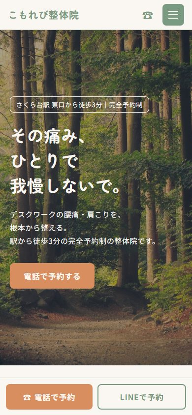
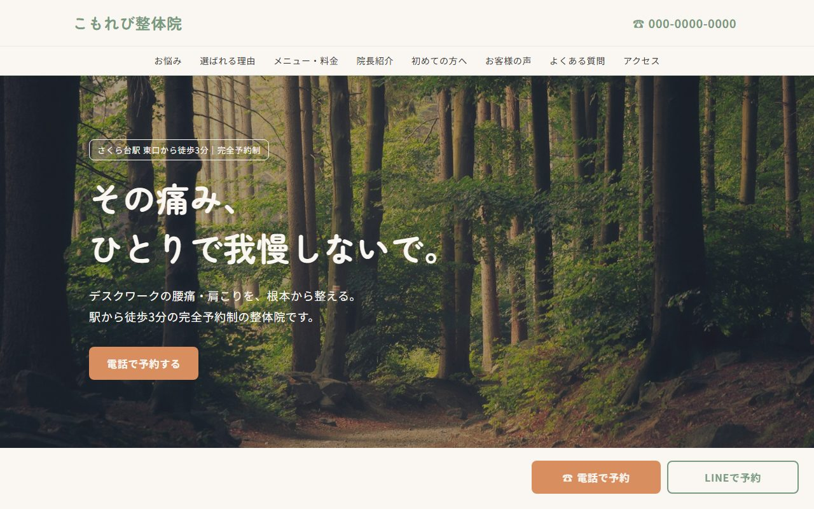

# こもれび整体院（架空）の1ページサイト

デスクワークの腰痛・肩こりに悩む人に向けた、架空の整体院のホームページです。
Web制作の練習として作りました。

> **このサイトは制作練習用の架空のお店です。**
> 店名・人物・住所・電話番号はすべて架空のものです。

## 画面

| スマホ | PC |
|---|---|
|  |  |

## 使ったもの

- HTML / CSS / JavaScript のみ（ライブラリやフレームワークは使っていません）
- フォント：[Zen Maru Gothic](https://fonts.google.com/specimen/Zen+Maru+Gothic)（見出し）、[Noto Sans JP](https://fonts.google.com/noto/specimen/Noto+Sans+JP)（本文）／Google Fonts
- 制作には [Claude Code](https://claude.com/claude-code) を使いました

## 工夫したところ

- **スマホ優先**：スマホの画面で先に完成させてから、PC向けに広げました
- **予約ボタンを常に表示**：電話・LINEの予約ボタンを画面の下に固定（PCでは右下）
- **色は4色だけ**：ベージュの背景、くすんだ緑、予約ボタンだけのオレンジ、文字色。清潔でやさしい雰囲気に
- **スマホ用メニュー**：右上の ≡ ボタンで開け閉め
- **よくある質問**：質問をタップすると答えが開け閉めします（HTMLの `<details>` を使用）
- **控えめな動き**：スクロールすると各セクションがふわっと表示されます（動きを減らす設定の人には動きなし）

## ページの構成

1. ヘッダー（店名・メニュー・電話）
2. トップ（写真＋キャッチコピー＋予約ボタン）
3. こんなお悩みありませんか
4. 選ばれる3つの理由
5. メニューと料金
6. 院長紹介
7. 初めての方へ（来院の流れ）
8. お客様の声
9. よくある質問
10. アクセス
11. フッター

## ファイル構成

```
shop-info-pra/
├── index.html      … ページの中身
├── style.css       … 見た目
├── script.js       … 動き（メニュー開閉・ふわっと表示など）
├── images/         … 院長のイラスト・地図・README用の画面写真
├── shop-info.md    … お店の設定書（文章・料金などの元）
├── CLAUDE.md       … デザインのルール（Claude Code向けの指示）
└── README.md       … この説明書き
```

## 見かた

`index.html` をブラウザ（Chromeなど）で開くと表示されます。
写真の一部はネット上から読み込んでいるため、インターネットにつながっている必要があります。

## 画像について

- 写真：[Unsplash](https://unsplash.com/) の無料写真
- 院長のイラスト・地図：無料のイラスト素材
